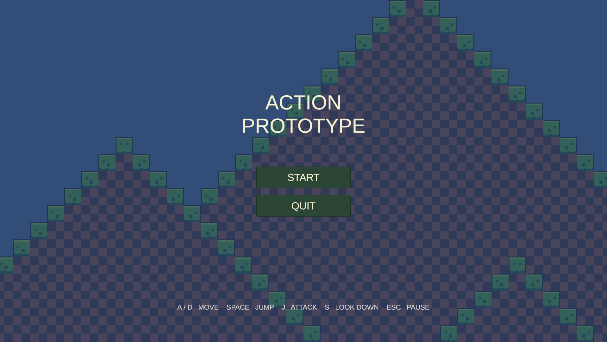
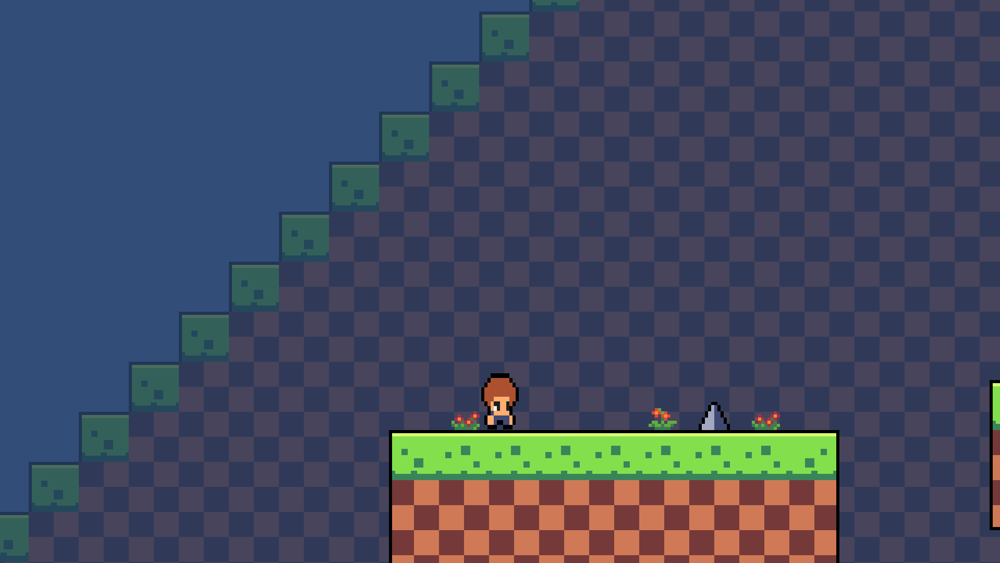
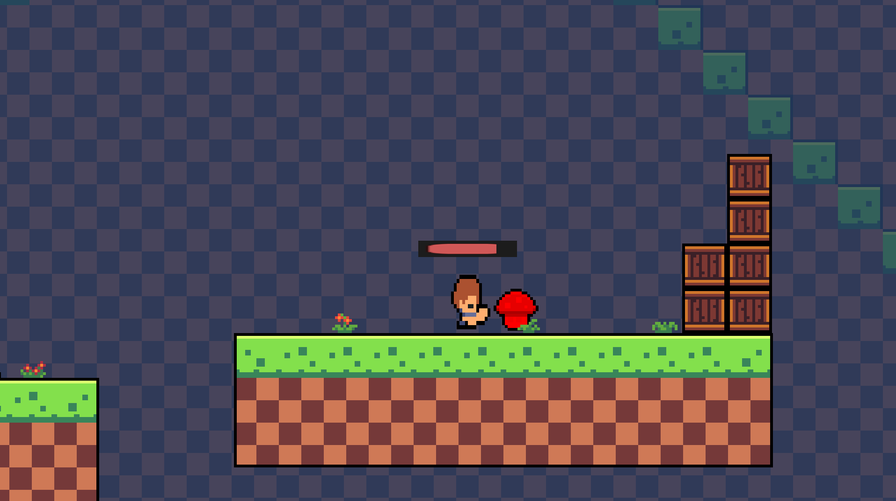
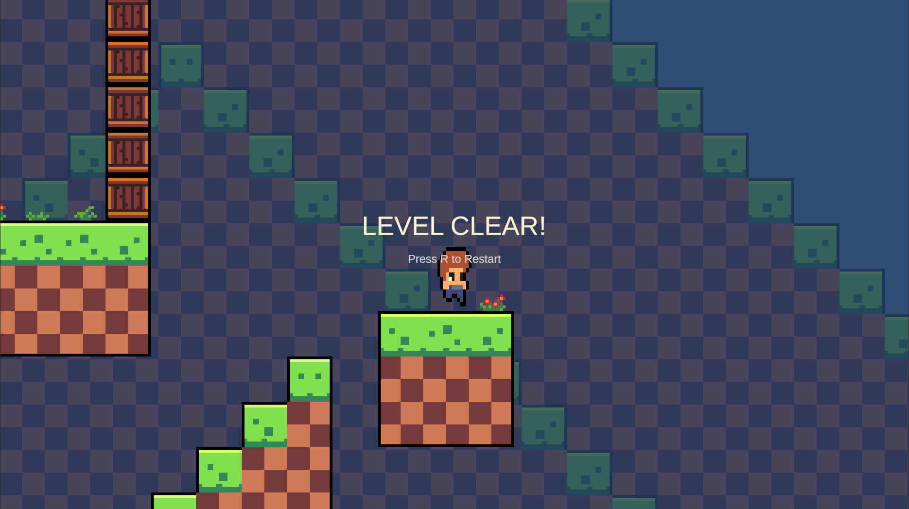

# ActionPrototype

A 2D action platformer prototype developed with Unity.

This project was created as a personal game development project to practice Unity, C#, 2D game mechanics, UI design, animation, audio, and level design.

## Download

[Download Windows Build - v0.1.0](https://github.com/zhenyao-dev/ActionPrototype/releases/tag/v0.1.0)

## Overview

The player explores a 2D platforming level while avoiding hazards and fighting enemies.

The goal is to reach the goal object at the end of the level.

## Features

- Player movement and jumping
- Melee attack system
- Enemy patrol AI
- Enemy contact damage
- Player knockback and invincibility
- Player and enemy hit feedback
- Player health system
- Contextual health bar
- Death and automatic restart
- Falling death
- Spike hazards
- Camera follow and look-down system
- Level clear system
- Main menu
- Pause menu
- Sound effects
- Background music
- Basic level design and environmental decoration

## Controls

| Key | Action |
| --- | --- |
| A / D | Move |
| Left / Right Arrow | Move |
| Space | Jump |
| J | Attack |
| S / Down Arrow | Look Down |
| Esc | Pause |
| R | Restart after Level Clear |

## Development Environment

- Unity 6
- C#
- Visual Studio Code
- Git / GitHub

## Screenshots

### Main Menu

### Gameplay

### Combat

### Level Clear

## What I Learned

Through this project, I practiced implementing a complete gameplay loop rather than only creating individual mechanics.

I learned how to connect player movement, combat, enemy behavior, damage feedback, UI, animation, sound, camera behavior, and level design into one playable prototype.

I also used Git and GitHub to manage development progress and separate changes into multiple commits.

## Future Improvements

- More enemy types
- Additional levels
- Improved combat effects
- More polished animations
- Additional environmental interactions
- Improved UI and visual effects

## Credits

### Music

Bitcade Free Music Pack Vol. 1  
by Schniersky  
Licensed under CC BY 4.0

### Sound Effects

Additional sound effects are from free game audio asset packs used for this prototype.

## Status

Prototype / Portfolio Project